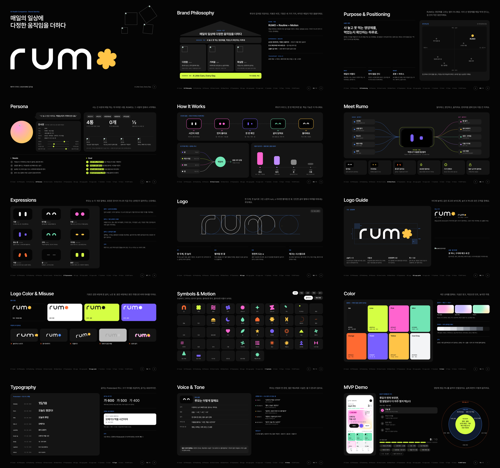
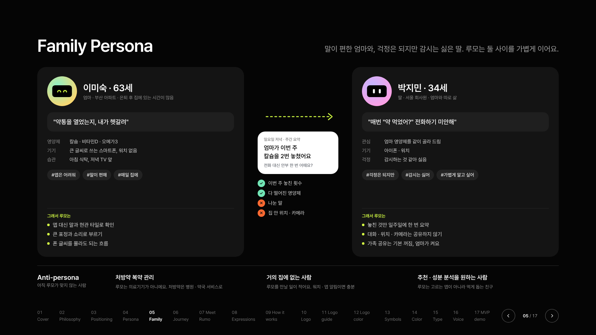
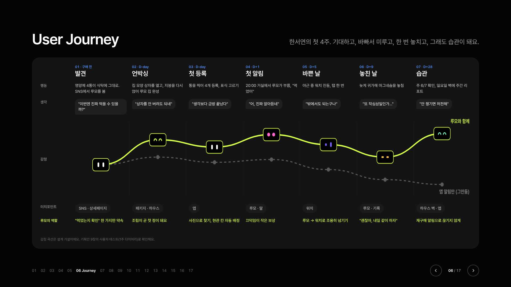
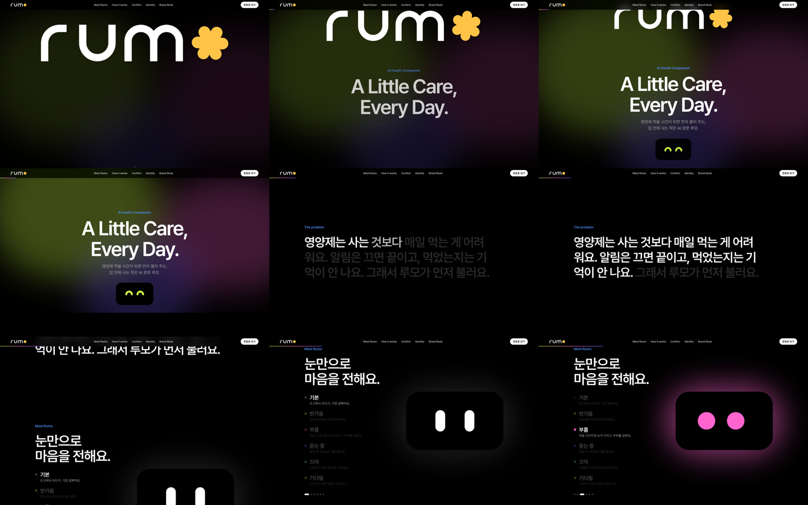
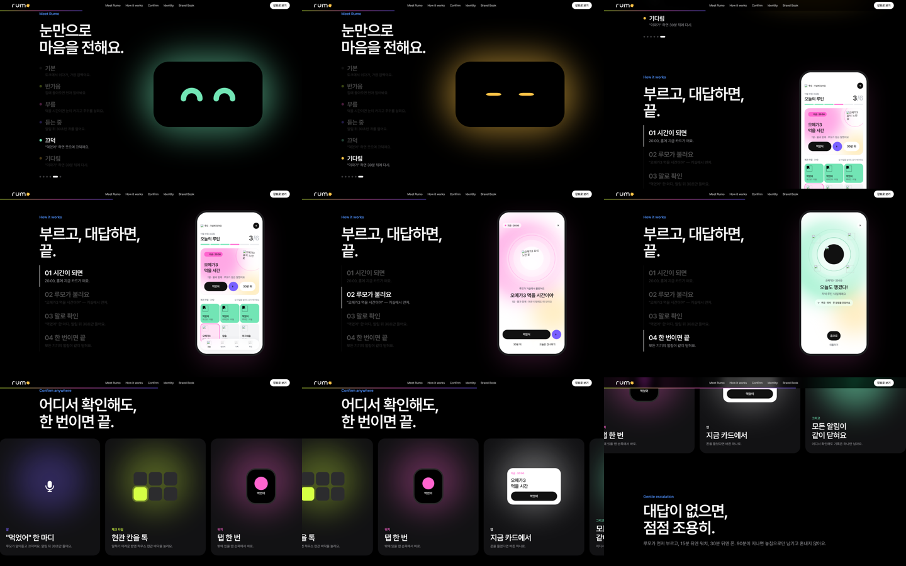
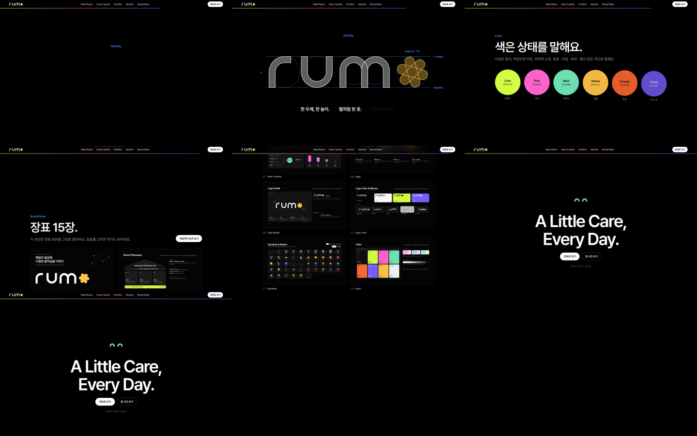

# RUMO — A Little Care, Every Day.

영양제 먹을 시간이 되면 먼저 불러 주는, 집 안에 사는 작은 AI 로봇 **루모**의 브랜드 · 앱 · 랜딩 디자인 소스예요.
패키지 디자인 기말 프로젝트 (김다솜).

## 사이트

- Vercel(추천 주소): https://rumo-brand.vercel.app · 앱 https://rumo-brand.vercel.app/app/ · 장표 https://rumo-brand.vercel.app/deck.html
- 랜딩페이지: https://dasomkim-create.github.io/rumo/
- 장표 넘겨 보기: https://dasomkim-create.github.io/rumo/deck.html
- 앱 프로토타입(직접 눌러 보기): https://dasomkim-create.github.io/rumo/app/

`docs/app/`은 캔버스의 앱 화면(`.dc.html`)을 그대로 읽어서 실제로 동작시켜요. 런타임 `dc-lite.js`는 이 레포용으로 새로 만든 가벼운 버전이에요.

`docs/`의 사이트는 캔버스에서 내보낸 정적 버전이에요(이미지로 고정). 캔버스를 고친 뒤에는 다시 내보내야 바뀌어요.

## 들어 있는 것

| 묶음 | 파일 | 내용 |
|---|---|---|
| 랜딩페이지 | `project/BrandSite.dc.html` | 애플식 스크롤 인터랙션 랜딩 (히어로 로고 스케치, 표정 전환, 앱 화면 전환, 가로 스크롤 카드, 스크롤로 그려지는 로고, 브랜드북) |
| 브랜드 장표 17장 | `project/Brand*.dc.html` | Cover → Philosophy → Positioning → Persona → Family Persona → User Journey → Meet Rumo → Expressions → How it works → Logo → Logo guide → Logo color → Symbols → Color → Type → Voice → MVP demo |
| 앱 화면 | `Onboarding` `Connect` `AddDose` `Main` `Meds` `Report` `Health` `Robot` `Alert` `Voice` `Done` `Watch` 등 | 390×844 모바일 시안, 예외 화면(`HomeOffline` `HomeEmpty` `AlertNoMic`) 포함 |
| 컴포넌트 | `Button` `Chip` `CheckTile` `ListRow` `TabBar` `TextField` `Segmented` … | 화면을 조립하는 조각 |
| 디자인 토큰 | `project/ds/rumo/tokens.json` | 색 · 타입 · 반경 · 모션 |
| 캔버스 배치 | `project/canvas.json` | 보드 위치와 페이지 구성 |

랜딩의 Brand Book 섹션과 폰 화면은 장표·앱 원본을 그대로 불러와요(`dc-import`). 장표나 앱 화면을 고치면 랜딩도 같이 바뀌어요.

## 파일 형식

`.dc.html`은 Claude Design 캔버스 형식이에요. HTML + `{{ }}` 바인딩 + `class Component extends DCLogic` 로직으로 되어 있고, 실행하려면 캔버스 런타임(`support.js`)이 필요해서 브라우저에서 바로 열면 그대로 보이지 않아요.
원본은 Claude Design 캔버스 "RUMO App"에서 편집해요.

이미지 심볼(`/_blob/…`)과 Pretendard 폰트는 캔버스에 올라가 있는 파일이라 이 저장소에는 들어 있지 않아요.

## 미리보기

| 가족 페르소나 | 유저 저니맵 |
|---|---|
|  |  |

| 랜딩 1 | 랜딩 2 | 랜딩 3 |
|---|---|---|
|  |  |  |
